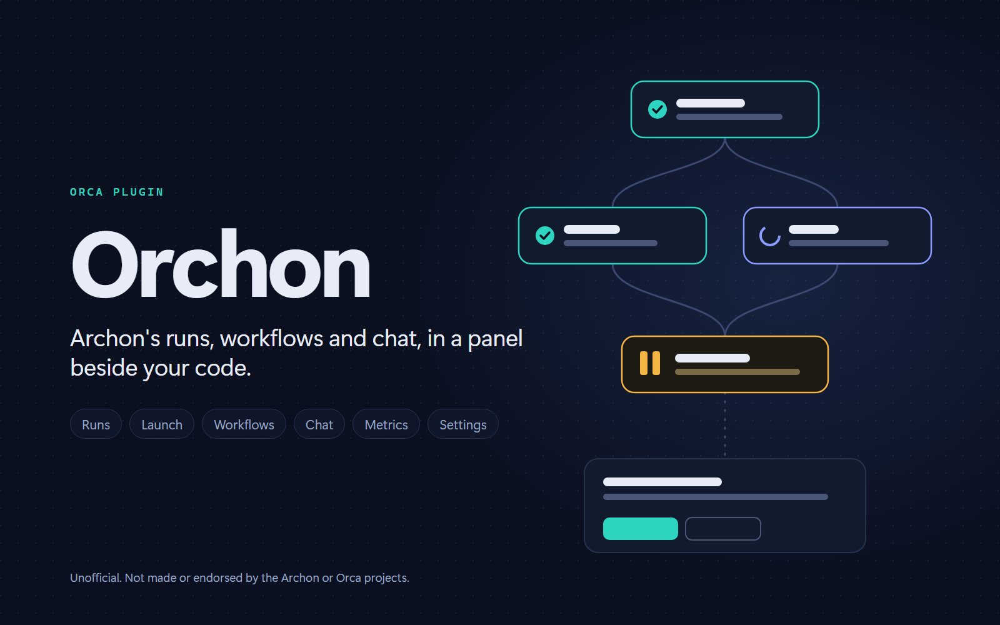
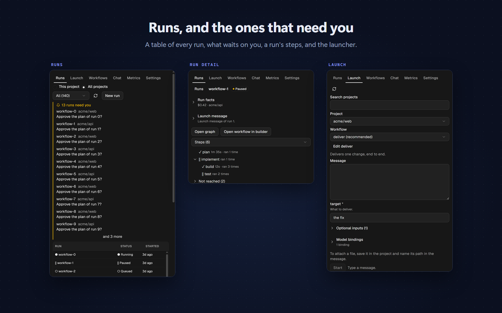
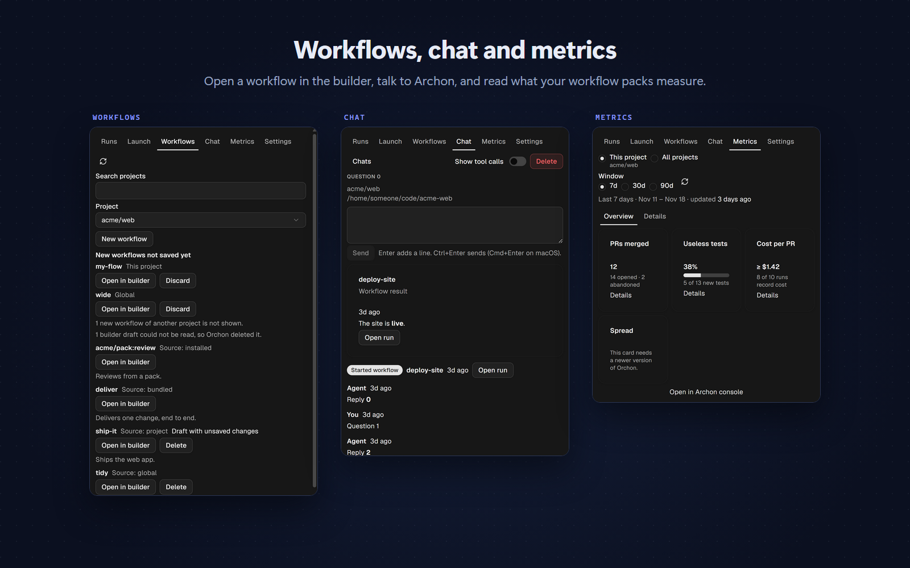
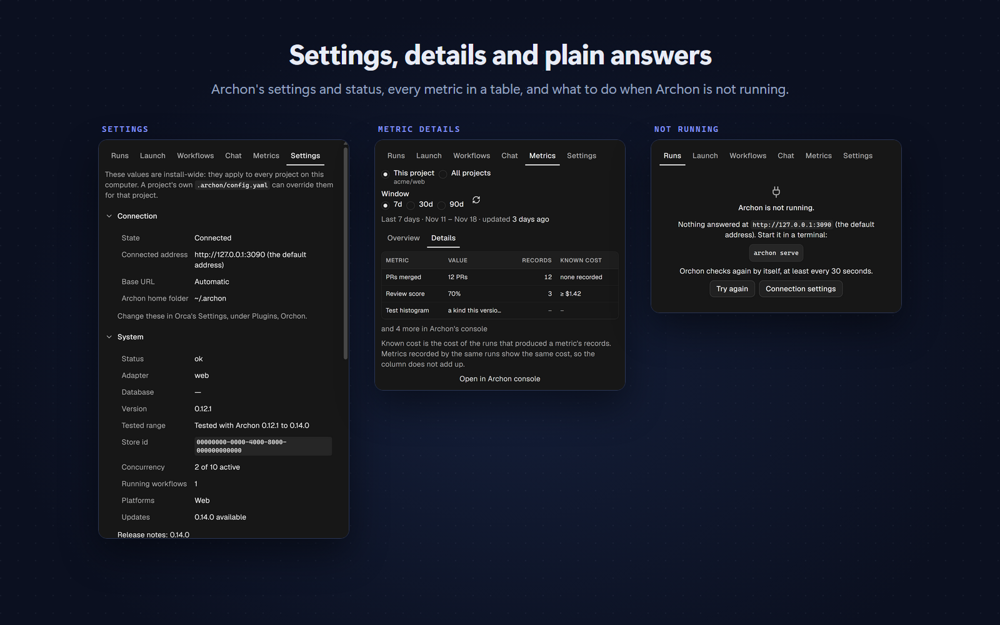

# Orchon



Archon's runs, workflows and chat inside Orca. Unofficial; not made or endorsed by the Archon or Orca projects.

[What is Orchon](#what-is-orchon) · [Features](#orchon-features) · [How to install](#how-to-install) · [Credits](#credits) · [What it does on your machine](#what-orchon-does-on-your-machine)

## What is Orchon

[Archon](https://github.com/coleam00/Archon) runs AI coding workflows: a workflow is a graph of steps, a run is one execution of it, and a run can stop to ask you a question before it goes on. Archon's console is a web page. [Orca](https://github.com/stablyai/orca) is a desktop app for running coding agents in workspaces.

Orchon is an Orca plugin that brings the Archon on your computer into Orca's sidebar, beside the code you are working on. It follows the workspace you are in and shows that project's runs, tells you when a run needs you, and lets you launch, answer, edit and chat without leaving Orca.

- **Local only.** Orchon talks to the Archon server on this computer and nothing else. It never starts or stops Archon, and it collects no usage data.
- **Careful with Archon.** It changes Archon only when you press a button, with [one exception](#the-presses-that-change-archon), and never sends a change twice. An answer names the question it was written for, so a stale answer is refused.
- **Free and open.** MIT licensed. See [LICENSE](LICENSE).

## Orchon features



### Runs

- A table of the project's runs, or every project's, with a status filter and its counts.
- A "runs need you" callout for runs waiting at a gate or for your answer.
- Run detail: the steps as a tree, each step's activity, output and facts, and the run's files.
- Cancel, resume, abandon and answer a run's questions, with Cancel and Abandon asking first.
- **Open graph** opens the run as a graph in a wide editor tab, with pan, zoom, a minimap and each step's state.

### Launch

- Pick a project and a workflow, type a message, fill the inputs the workflow declares, and choose model bindings.
- Orchon finds the new run and opens it, and **Re-run** fills the form from a run you already have.



### Workflows and the builder

- Every workflow Archon has for a project, with its source: project, global, bundled or installed.
- **Open in builder** opens a workflow in a wide editor tab: a canvas, an outline, an inspector and its YAML, with undo, validation and Save through Archon.
- Unsaved edits are kept as drafts and survive restarting Orca. A save first checks whether the workflow changed elsewhere, and asks before overwriting that change.

### Chat

- Talk to Archon's agent about the project. It can start workflows, and their results link to their runs.
- Drafts are kept per conversation, and tool calls show when you want them.

### Metrics

- The cards your workflow packs declare, and a table of every metric over 7, 30 or 90 days. Needs Archon 0.14.0 or newer.



### Settings

- The connection and Archon's status, and the default assistant, default models, model tiers and model aliases, each saved only when you press Save.

### Always in view

- A status bar item counts the runs that are running or need you, and a press shows them.
- Desktop notifications for runs that need you, and for runs that end when you choose.
- When Archon restarts or stops, Orchon keeps what it showed and says what to do.

Every detail of every section is in [Orchon in detail](docs/features.md).

## How to install

### You need

- [Orca](https://github.com/stablyai/orca) 1.4.248 or newer, the desktop app.
- [Archon](https://github.com/coleam00/Archon) 0.12.1 or newer, running on the same computer. Metrics needs 0.14.0 or newer. Start it with `archon serve`.

### From Orca's plugin directory

Find Orchon in Orca's plugin directory, on its page at [orca.dev/plugins](https://orca.dev/plugins/seanrobertwright/Orchon), and install it. Orca shows what Orchon asks to do before you approve it; [What Orchon does on your machine](#what-orchon-does-on-your-machine) explains each item.

### From GitHub, with the `orca` command

```sh
orca plugin install seanrobertwright/Orchon
```

Orca installs the newest version tag. It stops first and lists what Orchon would be allowed to do, with the command to run again with `--approve` and a fingerprint. Read the list, then run that command.

### First run

Open **Orchon** in Orca's right sidebar. Orchon finds Archon by itself: it reads `server.json` in `~/.archon`, and otherwise tries `http://127.0.0.1:3090`. When your Archon is elsewhere on this computer, set the **Base URL** or **Archon home folder** in Orca's Settings, under Plugins, Orchon. [How Orchon finds Archon](docs/features.md#how-orchon-finds-archon) has the details.

## Credits

Orchon is a window onto [Archon](https://github.com/coleam00/Archon), which is made by Cole Medin ([@coleam00](https://github.com/coleam00)) and Rasmus Widing ([@Wirasm](https://github.com/Wirasm)) and its contributors. The workflows, runs, chat and metrics Orchon shows are Archon's work.

- The workflow builder's rules for reading, editing, validating and writing a workflow are copied from Archon under its MIT licence; [THIRD_PARTY_NOTICES](THIRD_PARTY_NOTICES) has the notice.
- The plugin icon is Archon's shield mark, drawn as [Archon's brand sheet](https://archon.diy/brand) asks.
- [Orca](https://github.com/stablyai/orca) is made by [Stably](https://github.com/stablyai).

## What Orchon does on your machine

When you install Orchon, Orca asks you to approve what it may do, in words Orca writes itself. This is Orchon's own account. The Access group in Orchon's Settings section carries the short version.

### The worker's limits

Orca's line for Orchon's worker reads "Runs its own code in a separate Node.js process on the Orca host, with your user account's access to that machine." Nothing in Orca narrows that, so the worker holds itself to this list. Anything not on it is a defect.

| Kind | The worker may |
| --- | --- |
| Network | Make HTTP requests to this machine's loopback address, redirects off. Nothing else. |
| Disk, read | `server.json` in the Archon home folder; whether that folder exists; a local workspace's Git config, to read its remote. |
| Disk, write | Create and delete only inside `.orchon/` at the root of a local workspace: pointer files with its two suffixes, and that folder's `.gitignore`. |
| Processes | Start none. |

To keep its own files there, the worker also lists what is in that `.orchon` folder and reads its `.gitignore`. The Git remote is read from the repository's `.git/config` file by hand, since no process may be started. The lint gate enforces the list for every file Orca loads: none may load `node:child_process`, `node:net`, `node:http`, `node:https`, `node:tls`, `node:dgram` or `node:worker_threads`; only the disk module loads `node:fs`, and it refuses a path that leads outside the folders it was opened for once `..` and links are followed; only the client module calls `fetch`, and it refuses an address that is not loopback. Tests hold both refusals.

The panel and the editor tabs open a page in your browser only when you press a link. Orchon's own links go to Archon's console on the address Orchon is connected to, to Archon's installation guide (`archon.diy`), the one site outside this computer Orchon links to of its own accord, and to the release notes on `github.com` that Archon's update check names. Text from Archon, such as a chat message, may hold links of its own.

### What each approval is used for

| Capability | Used for |
| --- | --- |
| `workspace:read` | Following the workspace you are in (`workspace.readContext` and the `workspace.changed` event) and matching its Orca project to an Archon project (`workspace.list` and `project.list`). |
| `workspace:write` | Opening the run graph and workflow builder tabs, and a project workflow's file with **Open YAML** (`editor.open`), and showing a run's worktree with **Open in Orca** (`workspace.open`). |
| `storage:own` | Unsaved builder and chat drafts, saved project links, the ids of Orchon's own launch conversations, the workflow last launched in each project, and the chosen metrics window. |
| `settings:own` | Reading the three settings Orchon declares: Base URL, Archon home folder and Notifications. |
| `notifications:show` | Runs that need you, runs that end when you choose that in the Notifications setting, a launch Archon did not start while Launch was not showing, and the test notification you send from Settings. |

Orca's approval line for `workspace:write` also names renaming workspaces, hiding projects, focusing terminals and running built-in commands. Orchon does none of those: it uses `workspace:write` for `editor.open` and `workspace.open` only, and a test fails the build when Orchon's shipped code names any other `workspace:write` method (`workspace.rename`, `commands.run`, `project.setHidden` or `terminal.focus`).

### Background traffic

The worker runs for as long as the plugin is enabled, to keep runs and the status bar current. Without a press, and only to Archon on the loopback address, it:

- holds one connection to Archon's dashboard event stream open while connected;
- reads `GET /api/runs/attention` and `GET /api/dashboard/runs?limit=1` every 30 seconds while connected, and also on connecting and when Archon says a run's status changed, at most once every 2 seconds;
- holds one connection to a launch's conversation stream open while that launch waits for its run, at most 20, and looks for the run among the project's newest 50 runs every 2 seconds for 30 seconds and then every 10 seconds, until it is found;
- holds one connection to a chat's conversation stream open while its thread is on screen, at most 5;
- reads Archon's health every 30 seconds while the Settings section shows;
- while it cannot find Archon, looks again after 2 seconds and then at longer intervals, up to once every 30 seconds, and checks an Archon that is not supported every 30 seconds.

Each section and tab also reads what it shows from Archon while it is on screen, as the sections above describe. Orchon sends nothing anywhere else and collects no usage data.

### The presses that change Archon

Orchon changes Archon only when you press a control (or, in the workflow builder, `Ctrl+S` or `Cmd+S`):

- cancel, resume or abandon a run;
- answer a question: a gate or a run waiting for an answer;
- launch a workflow, which creates a conversation and starts a run in it;
- send a chat message, which creates the chat with its first message, or delete a chat;
- save or delete a workflow;
- change the default assistant, the default models, the model tiers or the model aliases;
- register a project with Archon, after you confirm its folder.

There is one exception: when Archon refuses a launch, Orchon deletes the conversation it created for that launch itself.

### What Archon does on its own

Runs and chats spend tokens with whichever model providers Archon is set up for. That traffic is Archon's, not Orchon's: Orchon never reads or stores provider keys, calls no `/api/auth/*` route and never starts another program.

Each launch makes Archon write a conversation title with its small model. That is one small model call per launch, and Orchon cannot turn it off.

### Where a run runs

A run started from Orchon runs where Archon runs. A launch sends Archon the Archon project and never a folder, and Archon runs the workflow in its own environment, in the folders it chooses. A workspace counts as on this computer when Orca lists it as local and, on Windows, its path is not a WSL share, so a project on a Windows drive that Orca opens with a WSL runtime counts as local, and a run started for it still runs where Archon runs.

## Releases

The newest version is the supported one. Every release, and what it changes, is in [CHANGELOG.md](CHANGELOG.md). Versions stay below 1.0.0 while Orca's plugin system is in Alpha.

What Orca asks you to approve changes only in a release whose minor version rises, and that release's changelog entry says, under "Asks you to approve again", what is new and why. A patch release never changes it. CI compares the approval surface with the last released tag on every pull request and push to `main`.

Before each tag, the owner runs the [live Orca checklist](docs/live-checklist.md) in Orca and signs it off.

## Development

How to build, check and test Orchon, its CI gates, its module bans and its recorded fixtures are in [Development](docs/development.md). In short: `npm ci`, `npm run types`, then `npm run check`.

## Licence

MIT. See [LICENSE](LICENSE). Licences of code copied from other projects are in [THIRD_PARTY_NOTICES](THIRD_PARTY_NOTICES).
